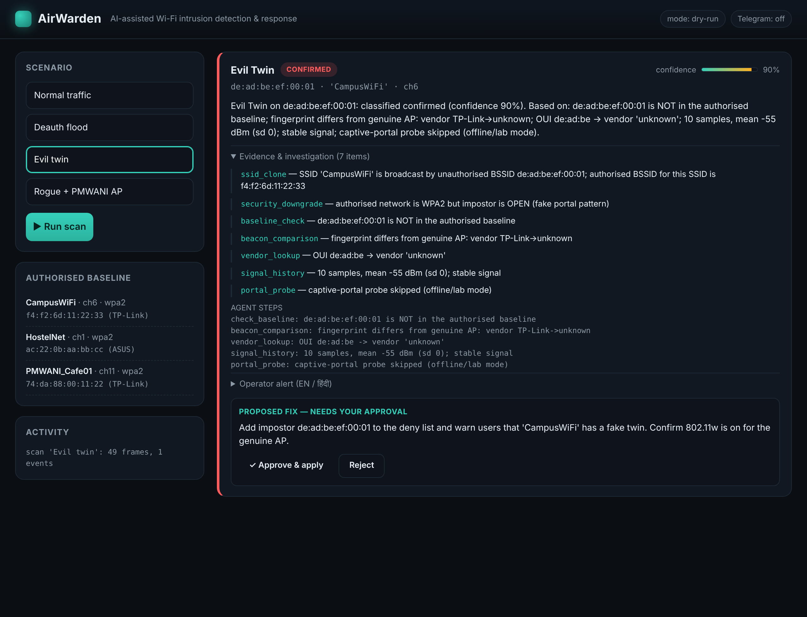

# AirWarden

**An AI security analyst for Wi-Fi — it detects attacks, investigates them with evidence, and applies an operator-approved, verified fix.**

ChronoForge 2026 · Track: **Cybersecurity** · Team **Vidyut**



---

## The problem

Small networks — college campuses, hostels, PM-WANI public hotspots, cafés,
clinics — get hit by Wi-Fi attacks that steal logins in minutes, and nobody
notices. Catching them needs two things these operators don't have: radio-level
monitoring **and** a security analyst to make sense of it.

## What AirWarden does

A low-cost sensor (Raspberry Pi or laptop) plus an AI agent that acts as the
missing analyst. For every alert it **detects → investigates → proposes a fix →
verifies** — the full loop, where ordinary tools stop at the alert.

- **Detects 8 attack classes** from captured 802.11 frames
- **Investigates** each alert like an analyst (baseline check, beacon
  comparison, vendor lookup, signal history, portal probe) and returns a
  **verdict with a confidence score and the evidence behind it**
- **Proposes a fix** on the operator's *own* router — applied **only after
  approval**, then **re-scanned to confirm it worked**
- **Bilingual alerts** (English + हिंदी) to a dashboard, email, and Telegram
- **Responsible by design** — passive monitoring, management-frame metadata
  only, **never transmits an attack frame**

## Attack coverage

| Attack | How it's detected |
|---|---|
| **Deauth / disassoc flood** | burst of spoofed management frames in a sliding window |
| **Evil twin** (cloned SSID) | trusted SSID broadcast by an unauthorised BSSID (+ security downgrade / fake portal) |
| **Rogue AP** | unknown BSSID advertising a new SSID (PMWANI-branded → escalated) |
| **Karma / MANA** | one BSSID answering probe requests for many different SSIDs |
| **Beacon flood** | surge of distinct unknown APs in a short window |
| **Auth / assoc flood** | burst of auth/assoc requests from many MACs at one AP |
| **SSID typosquat** | look-alike of a trusted SSID (homoglyph / edit distance) |
| **MAC spoofing** | sequence-number regressions = two radios sharing one BSSID |

Weak evidence is labelled **needs-review**, never reported as an attack. On
clean traffic AirWarden stays silent — **zero false alarms**.

## Quick start (no dependencies — Python 3.8+ stdlib only)

```bash
git clone https://github.com/arif671998-del/AirWarden && cd AirWarden
python3 tests/make_fixtures.py        # build the demo captures
python3 tests/run_all.py              # run the full test suite (all green)
python3 -m airwarden.server.app       # open http://127.0.0.1:8080
```

Then pick a scenario and **Run scan** — expand the evidence, click **Approve &
apply**, and watch the fix apply (dry-run) and verify.

**CLI:**
```bash
python3 -m airwarden analyze tests/fixtures/evil_twin.pcap --learn tests/fixtures/benign.pcap
```

**Live sensor** (monitor-mode adapter, passive only):
```bash
sudo python3 -m airwarden monitor wlan0mon --learn-seconds 20 --channels 1,6,11
```

## How it works

```
 capture ──▶ detect (rules) ──▶ investigate (agent) ──▶ respond
 pcap /       deauth, eviltwin,   plan → gather →         approve → apply (SSH)
 monitor      rogue, karma,       assess → recommend      → verify (re-scan)
 mode         beacon/auth flood,  → explain               OpenWrt UCI/ubus
              typosquat, spoof    confidence + evidence
```

The **detection core has no third-party dependencies**. Optional backends —
Scapy (live capture), LangGraph (explicit agent graph), a local/hosted LLM
(reasoning), SMTP/Telegram (alerts) — light up when present, so the system runs
and demos anywhere and keeps working offline. See
[`docs/ARCHITECTURE.md`](docs/ARCHITECTURE.md) and the demo walkthrough in
[`docs/DEMO.md`](docs/DEMO.md).

## Tech stack

Python · Scapy (monitor-mode capture) · rule detectors + SQLite baseline ·
LangGraph agent (+ optional local LLM via Ollama for offline sites) · OpenWrt
UCI/ubus over SSH · stdlib HTTP dashboard + vanilla-JS console · email (SMTP) &
Telegram alerts.

## Responsible use

- Monitoring is **passive**; only management-frame metadata is handled, never
  user traffic.
- AirWarden **never transmits attack frames** and never sends counter-deauth.
  Test "attacks" are crafted offline into `.pcap` fixtures — no radio is touched.
- Responses run **only on the operator's own router, only after approval**, and
  every fix is re-verified.

## Project layout

```
airwarden/
  schema.py      shared types (Frame, DetectionEvent, Verdict)
  pcap.py        stdlib pcap + radiotap + 802.11 codec
  baseline.py    SQLite trusted-AP store
  capture/       pcap replay + Scapy monitor-mode backend
  detect/        8 detectors + engine
  agent/         investigator (nodes), tools, llm, langgraph wrapper
  respond/       OpenWrt SSH actions + approval/verification
  alert/         EN/HI summaries, email + Telegram
  server/        dashboard + JSON API
  monitor.py     live capture→detect→investigate loop
web/             operator console
tests/           fixtures + 22 tests (run_all.py)
docs/            ARCHITECTURE.md, DEMO.md
```

## Team Vidyut

Mohd Arif Khan (lead) · Rohit Kumar · Mehul Doshi
